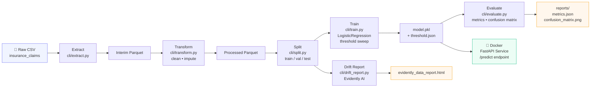

# 🛡️ Auto Insurance Fraud Detection — End-to-End MLOps Pipeline

<p align="center">
  
  
  
  
  
  
  
</p>

<p align="center">
  <strong>A reproducible ML pipeline that reads a prepared table of insurance claims, trains a fraud classifier, tracks each training run with MLflow, compares the train and test data with Evidently AI, and serves predictions from a FastAPI service in Docker. DVC runs the pipeline stages.</strong>
</p>

---

## 📋 Overview

Auto insurance fraud costs the industry billions of dollars annually and drives up premiums for honest policyholders. This project is a **reproducible, end-to-end MLOps pipeline** that classifies insurance claims as fraudulent or legitimate. The input is a prepared table of 1,000 claims with 33 feature columns. DVC defines and caches each pipeline stage. MLflow records each training run in the local `mlruns/` folder. A FastAPI service in a Docker container serves the trained model as a REST API.

---

## 🏗️ Architecture Diagram



> All stages are orchestrated and cached by **DVC** (`dvc.yaml`). Run the full pipeline with a single `dvc repro` command.

---

## ✨ Features

- **Automated ETL** — reads the raw CSV and converts it to Parquet. The transform stage has rules for text columns, missing values, and a `Y`/`N` target. The current data file is already numeric and complete, so these rules do not change it.
- **Stratified Train / Val / Test Splits** — reproducible splits of 700 / 100 / 200 rows (70 / 10 / 20 %) with configurable `random_state` and sizes in `params.yaml`
- **Sklearn Pipeline with ColumnTransformer** — `StandardScaler` for numeric columns and `OneHotEncoder` (unknown-safe) for text columns, inside a single serialisable `Pipeline` object. All 33 columns in the current data file are numeric, so the encoder has no columns to encode.
- **Class-Imbalance Handling** — `LogisticRegression` trained with `class_weight="balanced"`, because 24.7 % of the claims (247 of 1,000) are fraud
- **Threshold Optimisation** — sweeps 19 decision thresholds (0.05 → 0.95) on the validation set and selects the threshold that maximises F1-score; persisted to `models/threshold.json`
- **MLflow Experiment Tracking** — logs parameters, per-threshold metrics, ROC-AUC, and the full model artefact (with input signature and example). Runs go to the local `mlruns/` folder by default. Set the `MLFLOW_TRACKING_URI` environment variable to send runs to a remote server such as DagsHub.
- **Data Drift Monitoring** — generates an Evidently AI HTML report that compares the training and test distributions. Both sets come from one random split, so the report is a baseline. The same stage can compare training data with new production data.
- **DVC Pipeline Orchestration** — every stage declared in `dvc.yaml` with explicit dependencies and outputs; `dvc repro` runs only what changed
- **FastAPI Prediction Service** — `/predict` (POST), `/health` (GET), and `/` (GET) endpoints; model loaded once at startup from a configurable `MODEL_PATH` env variable
- **Docker Containerization** — single-stage `Dockerfile` using `python:3.11-slim`; a separate `requirements-serving.txt` keeps training dependencies out of the image
- **Request Validation** — a Pydantic model checks that each `/predict` request has a `features` object. The pipeline does not validate the data schema yet.
- **Config-Driven** — all paths, split ratios, and the target column name live in `params.yaml`. The model hyperparameters are set in `autoinsurance/pipeline/train.py`.

---

## 🛠️ Tech Stack

| Layer | Technology |
|---|---|
| Language | Python 3.11 |
| ML / Preprocessing | scikit-learn, NumPy, pandas |
| Experiment Tracking | MLflow ≥ 2.9 (local `mlruns/` by default) |
| Pipeline Versioning | DVC |
| Data Drift Monitoring | Evidently AI |
| Model Serving | FastAPI, Uvicorn |
| Containerization | Docker (python:3.11-slim) |
| Request Validation | Pydantic |
| Config Management | PyYAML (`params.yaml`) |
| Serialisation | joblib |

---

## 📁 Project Structure

```
fraud-detection-auto/
├── autoinsurance/
│   ├── etl/
│   │   ├── extract.py          # CSV → Parquet (raw → interim)
│   │   ├── transform.py        # Cleaning, imputation, target encoding
│   │   └── load.py             # Not used by the DVC pipeline
│   ├── pipeline/
│   │   ├── train.py            # Train / val / test split, model training, MLflow logging
│   │   └── evaluate.py         # Test-set evaluation, confusion matrix, drift report
│   └── serving/
│       └── app.py              # FastAPI REST service (/predict, /health)
├── cli/                        # DVC-invoked entry points
│   ├── extract.py
│   ├── transform.py
│   ├── split.py
│   ├── train.py
│   ├── evaluate.py
│   └── drift_report.py
├── data/
│   ├── raw/                    # Source CSV (tracked in Git)
│   ├── interim/                # Post-extract Parquet
│   ├── processed/              # Post-transform Parquet
│   └── splits/                 # train / val / test Parquet files
├── models/
│   ├── model.pkl               # Serialised sklearn Pipeline (created by the train stage)
│   └── threshold.json          # Decision threshold selected on the validation set
├── reports/
│   ├── metrics.json            # Test-set evaluation metrics
│   ├── confusion_matrix.png    # Confusion matrix plot
│   └── evidently_data_report.html  # Data drift HTML report
├── Dockerfile                  # Serving image (slim)
├── scripts/
│   └── loadtest.py             # Load test for the /predict endpoint
├── requirements.txt            # Training dependencies
├── requirements-serving.txt    # Serving-only dependencies
├── params.yaml                 # Pipeline configuration
├── dvc.yaml                    # DVC stage definitions
└── dvc.lock                    # Reproducibility lockfile
```

---

## 🚀 Getting Started

### Data

The data file is `data/raw/insurance_claimsV4.csv`, and it is in this repository. It has 1,000 claims, 33 feature columns, and 1 label column (`fraud_reported`). The categories are already encoded as 0 and 1 columns. The file is a prepared training dataset (cleaned). 

### Prerequisites

- Python 3.11+
- Docker (for serving)
- DVC (`pip install dvc`)

### Installation

```bash
# 1. Clone the repository
git clone https://github.com/dislam7991/fraud-detection-auto.git
cd fraud-detection-auto

# 2. Create and activate a virtual environment
python -m venv .venv
source .venv/bin/activate  # Windows: .venv\Scripts\activate

# 3. Install dependencies
pip install -r requirements.txt
```

The raw data file is in Git, so `dvc pull` is not necessary.

### Run the Full Pipeline

```bash
# Reproduce all stages (extract → transform → split → train → evaluate → drift_report)
dvc repro
```

DVC caches outputs at each stage — re-running only executes stages whose inputs changed.

### Run Individual Stages

```bash
python -m cli.extract    --params params.yaml   # Raw CSV → interim Parquet
python -m cli.transform  --params params.yaml   # Apply the cleaning rules
python -m cli.split      --params params.yaml   # Create train / val / test splits
python -m cli.train      --params params.yaml   # Train model & log to MLflow
python -m cli.evaluate   --params params.yaml   # Evaluate on test set
python -m cli.drift_report --params params.yaml # Generate Evidently drift report
```
### Run the Prediction API

Run the pipeline first. The API and the Docker build need the file `models/model.pkl`, which the train stage creates.

```bash
# Option 1: Local (uvicorn)
uvicorn autoinsurance.serving.app:app --reload --port 8000

# Option 2: Docker
docker build -t autoins-svc .
docker run -p 8000:8000 autoins-svc
```

**Send a test request from the browser (all systems):**

Open http://localhost:8000/docs, click `/predict`, click "Try it out", paste the request body below, and click "Execute".

**Request body:**

```json
{"features": {
  "incident_severity_Total Loss":0,
  "insured_hobbies_cross-fit":0,
  "insured_hobbies_chess":0,
  "incident_severity_Minor Damage":1,
  "auto_model_X6":0,
  "auto_make_Volkswagen":0,
  "insured_occupation_craft-repair":0,
  "insured_relationship_wife":0,
  "insured_hobbies_hiking":0,
  "auto_model_95":0,
  "auto_model_Neon":0,
  "insured_relationship_own-child":0,
  "auto_make_Honda":1,
  "vehicle_claim":4500,
  "insured_education_level_College":0,
  "insured_hobbies_reading":0,
  "insured_relationship_not-in-family":1,
  "insured_occupation_tech-support":0,
  "insured_occupation_armed-forces":0,
  "auto_model_A5":0,
  "insured_hobbies_camping":0,
  "auto_model_Malibu":0,
  "insured_education_level_Masters":0,
  "incident_state_WV":1,
  "auto_model_Civic":1,
  "insured_hobbies_skydiving":0,
  "insured_occupation_handlers-cleaners":0,
  "incident_state_VA":0,
  "insured_relationship_other-relative":0,
  "insured_hobbies_video-games":0,
  "collision_type_Rear Collision":0,
  "collision_type_Side Collision":0,
  "insured_hobbies_yachting":0
}}
```

**Send the request from a terminal (Linux and macOS):**

Save the request body as `example_request.json`, and run this command.

```bash
curl -X POST http://localhost:8000/predict \
  -H "Content-Type: application/json" \
  -d @example_request.json
```

**Send the request from a terminal (Windows PowerShell):**

```powershell
Invoke-RestMethod -Uri http://localhost:8000/predict -Method Post -ContentType "application/json" -InFile example_request.json
```

**Example response:**

```json
{
  "prediction": 0,
  "proba": 0.0650509449573563
}
```

---

## 📊 Model Performance

> Metrics are computed on the held-out **test set** (200 claims, 49 of them fraud) using the threshold selected on the validation set (100 claims, 25 of them fraud). These numbers come from a full pipeline run on 2026-11-23 with `random_state: 42`.

| Model | AUC-ROC | F1-Score | Precision | Recall | Threshold |
|---|---|---|---|---|---|
| Logistic Regression (balanced) | 0.82 | 0.57 | 0.69 | 0.49 | 0.75 |

At the 0.75 threshold, the model flags 35 of the 200 test claims. 24 of the 35 flagged claims are fraud, and the model does not flag 25 of the 49 fraud claims.

> 📌 *Each run logs its metrics to MLflow and writes them to `reports/metrics.json`.*

**Key design choices affecting metrics:**
- `class_weight="balanced"` trades precision for recall. At a 0.5 threshold on the test set, recall is 0.71 with balanced weights and 0.49 without them. Precision is 0.61 with balanced weights and 0.69 without them.
- Decision threshold is tuned on the validation set to maximise F1, not fixed at 0.5
- ROC-AUC used as the primary ranking metric; F1 used for threshold selection

---

## 🔧 MLOps Components

| Component | Implementation |
|---|---|
| **Experiment Tracking** | MLflow (autolog + manual metric/param logging) to local `mlruns/`, or to a remote server through `MLFLOW_TRACKING_URI` |
| **Model Logging** | MLflow logs the model with an input signature and an input example. The project does not use the MLflow Model Registry. |
| **Pipeline Versioning** | DVC stages in `dvc.yaml` with `dvc.lock` for full reproducibility |
| **Data Versioning** | The raw CSV is in Git. `dvc.lock` records a hash for each stage output. |
| **Threshold Optimisation** | Validation-set sweep across 19 thresholds; best persisted to `models/threshold.json` |
| **Data Drift Monitoring** | Evidently AI `DataDriftPreset` report comparing train vs. test distributions (a baseline) |
| **Model Serving** | FastAPI REST API with a health check and a Pydantic request model. The API loads the model at startup and tries again on the first request if the load failed. |
| **Containerization** | Docker image from `python:3.11-slim` with serving-only deps for a minimal footprint |
| **Config Management** | Single `params.yaml` controls all paths, split ratios, and target column name |
| **Schema Validation** | Not implemented yet. The API checks only that a request has a `features` object. |

---

## 💡 Results / Key Findings

- **Fraud is the minority class** — 24.7 % of the claims are fraud. Balanced class weights raised test recall at a 0.5 threshold from 0.49 to 0.71, and precision fell from 0.69 to 0.61.
- **The tuned threshold did not generalise** — the sweep selected 0.75 on the 100 validation claims, where F1 rose from 0.64 (at 0.5) to 0.70. On the 200 test claims, F1 at 0.75 is 0.57, and F1 at 0.5 is 0.66. A validation set with 25 fraud claims is too small to select a threshold reliably.
- **The data file is already prepared** — 32 of the 33 feature columns are 0/1 indicator columns, and `vehicle_claim` is the only continuous column. Someone selected and encoded these columns before this pipeline. If that selection used the fraud label on all 1,000 rows, the test metrics are too optimistic.
- **The drift report found no drift** — Evidently detected drift in 0 of 34 columns between the training and test sets. This is the expected result for a random stratified split, and it gives a baseline for later comparisons with new data.
- **Serving speed is measured.** The serialized scikit-learn pipeline is about 6 KB. The FastAPI service handled 141 to 154 requests per second with 0 errors across 4 local load tests. Each test sent 2,000 requests from 16 parallel clients to 1 uvicorn worker on a laptop. Median latency under that load was 87 to 92 ms, and each prediction takes about 7 ms of server time. Repeat the test with `python scripts/loadtest.py`.
---

## 📜 License

This project is licensed under the **MIT License** — see the [LICENSE](LICENSE) file for details.

